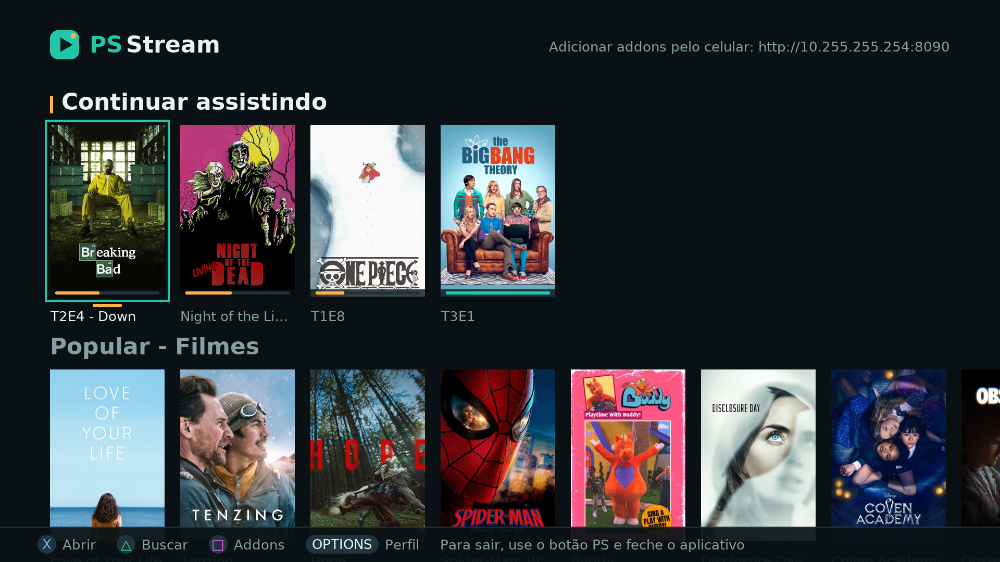
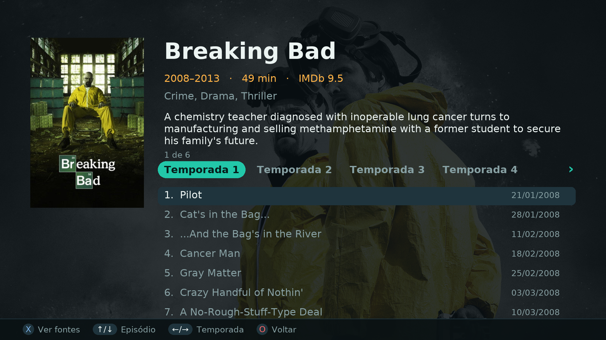
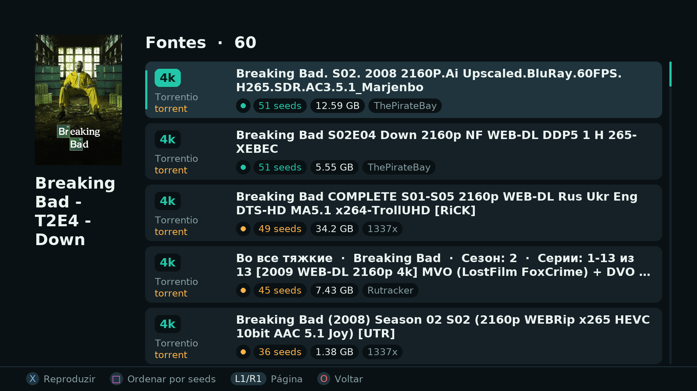
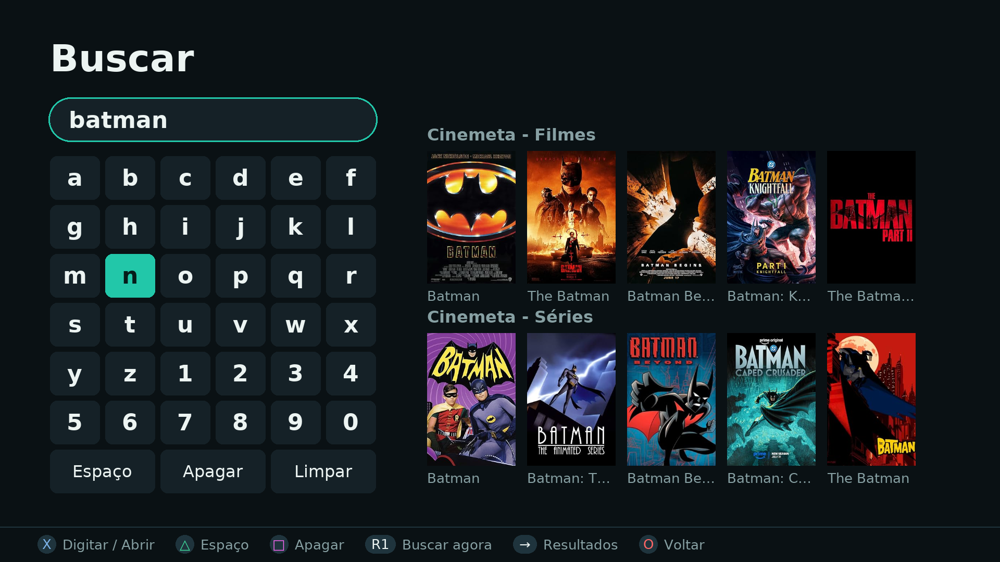
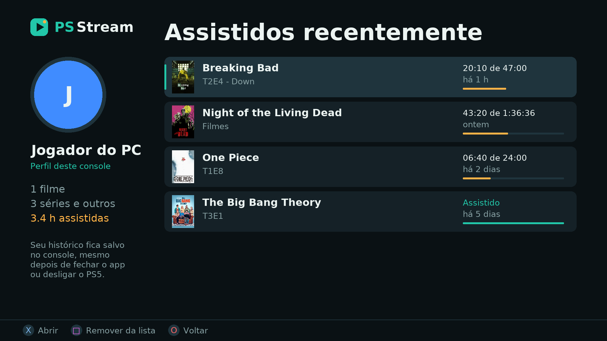
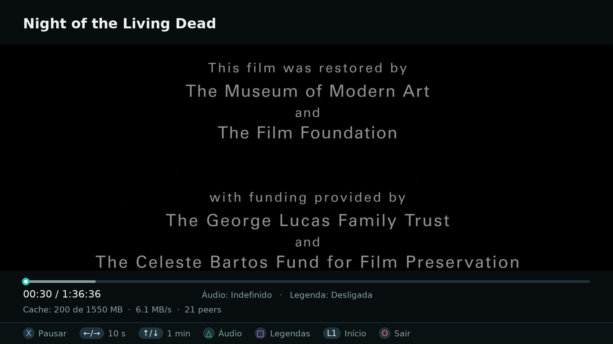
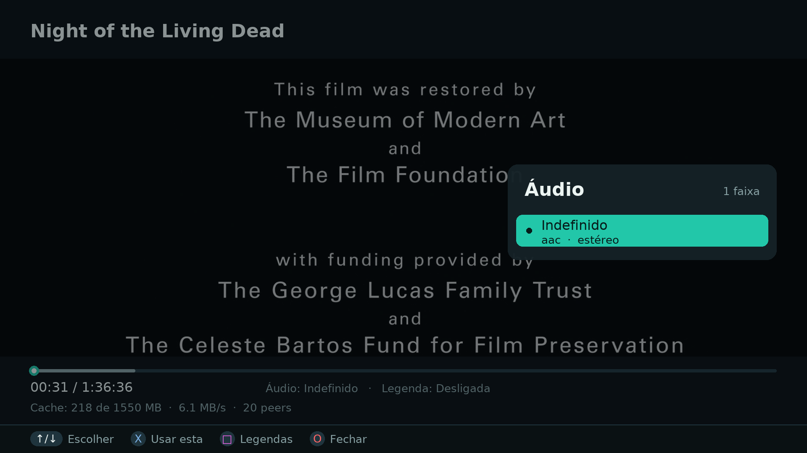

# PS-Stream

[English](README.md) · **Português**

Central de filmes e séries para o **PS5 desbloqueado**, em tela cheia e controlada pelo DualSense. Usa os mesmos addons do ecossistema Stremio (catálogos e fontes) e reproduz vídeos por **link direto ou torrent, tudo no próprio console**. Não precisa de PC nem de servidor na rede.



## O que faz

- **Catálogos** de filmes e séries vindos dos addons instalados (Cinemeta, FenixFlix…), com pôsteres e informações de cada título.
- **Busca** com teclado na tela, navegável pelo controle.
- **Séries por temporada**, com a lista de episódios e o progresso de cada um.
- **Fontes de vídeo** com qualidade (4K, 1080p…), tamanho, origem e **quantidade de seeds**, para escolher a melhor. Dá para ordenar por seeds.
- **Torrents no console**: o vídeo começa a tocar enquanto baixa, sem esperar o download terminar.
- **Player** com avanço e retrocesso, barra de progresso, lista de **faixas de áudio** e **legendas**.
- **Continuar assistindo**: o vídeo volta de onde você parou. A home e o perfil mostram uma entrada por obra, no último episódio visto.
- **Perfil** com os títulos assistidos recentemente e o tempo assistido.
- **Ícone na tela inicial** do PS5. O cache de vídeo é apagado quando o app fecha.
- **Addons padrão** já instalados: Cinemeta, FenixFlix e Torrentio. Dá para adicionar outros pelo app ou pelo celular, na página de configuração em `http://<ip-do-ps5>:8090`.

## Capturas

| Detalhes da série | Fontes com seeds |
|---|---|
|  |  |

| Busca | Perfil |
|---|---|
|  |  |

| Player | Lista de áudio e legendas |
|---|---|
|  |  |

## Requisitos

- PS5 desbloqueado, com um carregador de payloads ELF (elfldr na porta 9021, como o do etaHEN ou do ps5-payload-dev). Testado no firmware 13.60.
- Internet no console.

## Instalação

1. Baixe o **[ps-stream.elf (v0.3.7)](https://github.com/faelmaceedo/ps5-stream/releases/download/v0.3.7/ps-stream.elf)**.
2. Envie o ELF para o PS5 pelo seu carregador de payloads. Por exemplo, a partir do PC:
   ```sh
   nc -q0 <ip-do-ps5> 9021 < ps-stream.elf
   ```
3. Aparece a notificação **"PS-Stream pronto"**, e o ícone do PS-Stream fica na tela inicial.
4. Abra pelo ícone.

O payload precisa ser carregado de novo a cada vez que o console for ligado, como qualquer payload. O ícone continua na tela inicial.

## Controles

| Botão | Navegação | Player |
|---|---|---|
| ✕ | Abrir / escolher | Pausar / continuar |
| ◯ | Voltar | Sair do vídeo |
| △ | Buscar (na busca: espaço) | Lista de áudios |
| □ | Ordenar fontes por seeds (na busca: apagar) | Lista de legendas |
| ← → | Navegar | 10 s para trás / para frente |
| ↑ ↓ | Navegar | 1 min para frente / para trás |
| L1 / R1 | Páginas (na busca: R1 busca na hora) | L1 volta ao início |
| Options | Perfil | |

## Ao abrir pelo ícone

O PS5 mostra por um instante a tela **"Abrindo PS-Stream…"** e logo troca para o app. Se essa tela ficar parada, o app já está aberto por trás: aperte **◯** para voltar para ele.

## Problemas

Os registros ficam em `/data/ps-stream/launcher.log` no console (acessível por FTP). Ao abrir uma issue, anexe esse arquivo.

## Aviso

O PS-Stream não hospeda, indexa nem distribui conteúdo. Ele só exibe o que os addons configurados pelo usuário fornecem. Você é responsável pelo que acessa e por respeitar as leis do seu país.

O PS-Stream não tem ligação com a Sony, a Stremio ou os autores dos addons.

## Créditos

- [ps5-payload-dev](https://github.com/ps5-payload-dev): SDK, SDL2 para PS5 e o carregador de homebrew do websrv (GPLv3).
- [libtransmission](https://transmissionbt.com/): torrents.
- [FFmpeg](https://ffmpeg.org/) e [SDL_kitchensink](https://github.com/katajakasa/SDL_kitchensink): reprodução de vídeo.
- [Jansson](https://github.com/akheron/jansson) e [libcurl](https://curl.se/).
